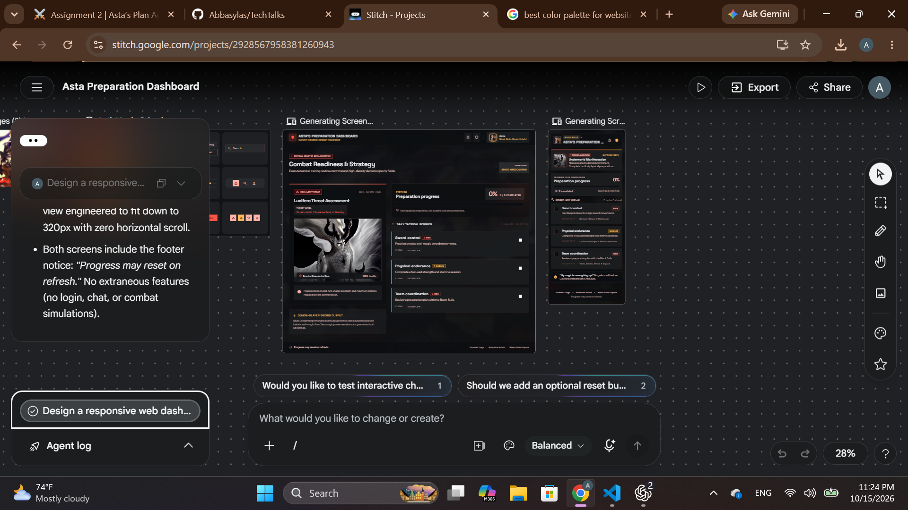
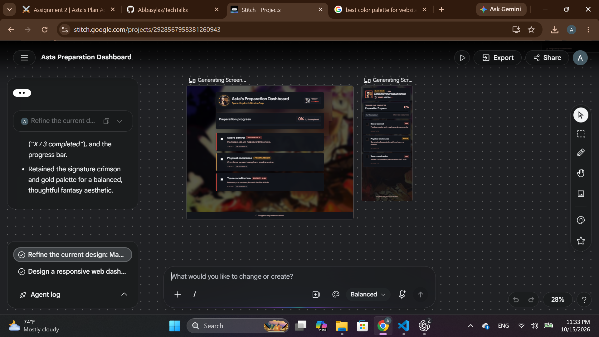

# Design

Status: MVP implemented on 16 October 2026. Historical reviews are retained below; current implementation and verification are recorded in the final section and REVIEW.md.

Use [PRD.md](PRD.md) as the source of product requirements.

## Review evidence and limits

The supplied screenshot shows desktop and mobile designs inside Stitch at 28% canvas zoom. Review concerns below refer to the dashboard previews, not the surrounding Stitch or browser controls. Fine text, exact font sizes, colour contrast, control dimensions, keyboard behaviour, and actual mobile overflow cannot be verified from this screenshot. Text in the Stitch conversation is not proof that accessibility or functionality passes.

## Updated mockup

Source: Screenshot (27).png, supplied by the user on 15 October 2026. This is the latest supplied design reference; the original screenshot above is retained for comparison.

Visible improvements include a more prominent Asta dashboard title, a compact character header, preparation progress above three stacked task cards, left-aligned completion controls, removal of the large threat and sword-output panels, and more visible background artwork behind dark content panels. The crimson and gold accents remain.

The requested direction is a more human, thoughtfully composed interface: natural wording, balanced spacing, restrained decoration, and fewer redundant labels. Keep the background recognisable by reducing the dark overlay where needed, while preserving opaque text panels and readable contrast. This supersedes the earlier suggestion to start with an approximately 80% overlay.

The updated screenshot is also at 28% canvas zoom. It records visual progress, not proof of font sizes, contrast, mobile usability, checkbox state, or working interactions. Full-size review and prototype checks remain necessary.

## Original review recommendations

The following table records the initial review. Several layout corrections are visible in the updated mockup above; remaining details require full-size verification.

| Priority | Visible concern | Proposed change |
| --- | --- | --- |
| High | The desktop headline emphasises “Combat Readiness & Strategy,” while the product title is small in the top bar. | Make “Asta’s Preparation Dashboard” the main heading. Use “Preparing for Lucifero” as the short subtitle. Avoid wording that implies measured combat readiness. |
| High | A large Lucifero threat assessment panel competes with progress and tasks. Threat levels, operation details, and sword-output content add unrelated information. | Remove these panels and invented metrics. Keep Lucifero as a small contextual portrait within the header. Give the available space to preparation progress and the task list. |
| High | Progress is confined to the right column beneath the desktop introduction. | Move one full-width preparation summary directly below the header. Show a prominent percentage, the completed / total count, and one horizontal progress bar. |
| High | Desktop checkboxes appear at the far right, while mobile checkboxes appear at the left. Their visible marks are very small at this zoom. | Place a labelled checkbox on the left of every task on both layouts. Provide a minimum 44 × 44px activation area and an unmistakable unchecked initial state. Verify actual dimensions at full size. |
| High | Descriptions, statuses, and supporting labels look visually subordinate and dense in the scaled previews. | Use 16px descriptions with 1.5 line height and 14px status and badge text. Remove unnecessary tiny labels. Verify readability at 100% zoom before judging final size. |
| Medium | Desktop uses a broad threat column and a narrower task column; mobile gives antagonist content early prominence. | Use the same content order on both: compact character header, preparation summary, three stacked task cards, refresh note. |
| Medium | Decorative warnings, quotes, utility icons, and footer-style labels add visual competition. | Remove nonessential warnings, motivational quote panels, navigation-like labels, and inactive utility icons from the dashboard itself. Keep exactly the three task interactions. |
| Medium | The background artwork is difficult to identify in the screenshot. | Use images (2).jpg as the page background with a dark overlay starting around 80% opacity. Adjust only enough to reveal atmosphere while keeping panels and text clear. |
| Medium | The antagonist portrait dominates the desktop artwork. | Use images (3).jpg as Asta’s header portrait and images (4).jpg as a smaller Lucifero portrait beside the subtitle. Preserve proportions and keep both secondary to the title. |

## Target layout and content

1. **Header:** Asta portrait, “Asta’s Preparation Dashboard,” and “Preparing for Lucifero” with a smaller Lucifero portrait. Allow wrapping on mobile.
2. **Preparation summary:** “Preparation progress,” initial value “0%,” count “0 / 3 completed,” and an empty horizontal progress bar. Use a 12px-high track.
3. **Training tasks:** Three full-width stacked cards, each with a left checkbox, task name, description, priority badge, and explicit status. On mobile, badges and status may wrap below the description.
4. **Footer note:** “Progress may reset on refresh.”

| Task | Description | Priority | Initial status |
| --- | --- | --- | --- |
| Sword control | Practise precise anti-magic sword movements. | High | Incomplete |
| Physical endurance | Complete a focused strength and stamina session. | Medium | Incomplete |
| Team coordination | Review a preparation plan with the Black Bulls. | High | Incomplete |

## Colour and imagery specification

| Role | Value | Use |
| --- | --- | --- |
| Page base | #0B0B10 | Beneath background artwork |
| Panel surface | #16161F | Nearly opaque summary and task cards |
| Raised surface | #20202B | Hovered cards and badge backgrounds |
| Decorative border | #383844 | Subtle panel separation; use a stronger treatment where a control boundary requires it |
| Primary text | #F5F2ED | Headings, task names, progress values |
| Secondary text | #B8B5C2 | Descriptions and supporting labels |
| Crimson accent | #F05264 | Progress, checked controls, focus indicators |
| Muted gold | #D8B46A | Priority labels and restrained decoration |

Use a small crimson edge accent consistently. Avoid large glows or additional accent colours. Do not use priority colour as the only label. Render background imagery with proportional cropping rather than stretching; avoid enlarging the small portrait sources into prominent panels.

## Typography and spacing specification

| Element | Target |
| --- | --- |
| Heading font | Barlow Condensed, weight 700; sans-serif fallback |
| Body and controls | Inter, weights 400–600; sans-serif fallback |
| Main heading | 40px desktop / 30px mobile; line height 1.1 |
| Section headings | 24px; line height 1.2 |
| Task names | 18px; weight 600 |
| Descriptions | 16px; line height 1.5 |
| Status and badges | 14px |
| Preparation percentage | 48px desktop / 36px mobile; bold; tabular numerals |
| Content width | Maximum 1040px, centred |
| Page padding | 40px desktop / 16px mobile |
| Section gaps | 32px desktop / 24px mobile |
| Panel padding | 24px desktop / 16px mobile |
| Task card gaps | 12px |
| Name-to-description gap | 8px |
| Panel corners | 12px radius |

Reserve uppercase text for short section labels. Keep descriptions in sentence case. Use natural card heights so content can wrap without clipping.

## Interaction and accessibility requirements

- All three checkboxes start unchecked. Show “Incomplete” until checked, then “Complete.” Completion can be undone.
- Keep completed task content readable; communicate completion with text and a checkmark as well as colour.
- Update percentage, count, and progress bar together: 0 / 3 = 0%, 1 / 3 = 33%, 2 / 3 = 67%, 3 / 3 = 100%. Priorities do not affect weighting.
- Support Tab navigation and Space to toggle, with visible focus and no focus movement after a toggle.
- Associate each checkbox with its task name. Provide an accessible progress label and value, and politely announce updated progress.
- Verify contrast against the final composited background: 4.5:1 for normal text, 3:1 for large text, and 3:1 for essential control indicators.
- Verify a readable 320px-wide layout without horizontal scrolling. Decorative images must not interrupt the accessible reading order.
- No animation is required.

## Follow-up verification

- [ ] Capture the revised desktop and mobile screens at readable scale in evidence/.
- [ ] Confirm the agreed section order, exact task content, and removal of unrelated panels.
- [ ] Verify font sizes, spacing, contrast, and control activation areas in the actual design or implementation.
- [ ] Test initial, partial, complete, and undone completion states.
- [ ] Check keyboard operation, screen-reader announcements, and the 320px layout in a working prototype.

Both the original and updated screenshots are preserved in evidence/. The updated capture includes desktop and mobile previews at reduced scale; full-size captures and passing test results remain pending.

## Browser saving update (16 October 2026)

The user added localStorage persistence. Replace the earlier refresh-reset footer with “Progress is saved in this browser.” Show “Loading saved progress…” while restoring state, and disable completion controls until restoration finishes. When saving is unavailable, show “Browser saving is unavailable. Progress may reset on refresh.” The layout and plain POC scope remain unchanged.

## Implemented MVP (16 October 2026)

The refined Stitch desktop and mobile screens were retrieved through `mcp__stitch__get_screen`, and their HTML exports were downloaded and inspected. The implementation follows their single-column header → progress → task cards layout, dark panels, crimson and gold accents, Asta portrait, smaller Lucifero portrait, and visible background. The local earlier Barlow Condensed/Inter suggestion is superseded by the selected Stitch fonts: Space Grotesk and Plus Jakarta Sans, served locally with their licenses so builds do not fetch fonts.

The supplied images are used exactly: images (2).jpg → background, images (3).jpg → Asta portrait, images (4).jpg → Lucifero portrait. Copied JPG file hashes match the originals. The background uses a 55% dark overlay plus a subtle vertical gradient; opaque text panels protect readability. No replacement AI artwork is used.

The implementation retains the reviewed 1040px content width, 12px panel radius, 16px task descriptions, 14px badges/statuses, and 44px activation targets. It uses the reviewed crimson #F05264 and gold #D8B46A. Task section headings and saving text also have dark surfaces so they remain readable over the artwork. A brief goal/threat introduction and visible preparation-plan explanation satisfy the final acceptance checklist. No decorative action buttons were introduced.

The original POC is preserved in Git history. Static page/header and local assets remain outside the small stateful Client Component. Refresh now preserves completion as requested; earlier reset-footer examples are historical.

Production screenshots: [desktop](evidence/mvp-1440.png), [360px](evidence/mvp-360.png), [320px](evidence/mvp-320.png), and [focus](evidence/mvp-keyboard-focus.png). Layouts were visually inspected; measured contrast and functional results are in [REVIEW.md](REVIEW.md). Actual screen-reader speech and other browsers remain unverified.

## Character context and background restoration (16 October 2026)

The user requested a visible Lucifero side card like Screenshot (32), plus Asta’s second supplied portrait and short character descriptions. This explicitly expands the earlier minimal layout with supporting character context. There are still exactly three training tasks and three core training features; no combat metrics, simulation, routes, accounts, editing, or database were added.

Desktop now uses a 288px left character column and the preparation plan on the right. On mobile the character cards follow the training controls. Each original portrait has a visible description and a native keyboard-operable disclosure for additional context. These are real controls with visible focus, not decorative buttons. The existing stateful Client Component and localStorage task logic are unchanged.

The original background was 596 × 335 and looked soft when enlarged. A non-destructive AI-assisted restoration produced a 1672 × 941 version at `public/images/black-bulls-background-restored.png`. It is served directly without additional optimizer recompression or a CSS blur filter. The original `black-bulls-background.jpg` is preserved. Restoration improves the appearance but can reconstruct or alter small line details; it is not a higher-resolution original from the artist. Both portrait files remain the supplied originals.

Evidence: [new reference](evidence/character-sidebar-reference.png), [desktop](evidence/characters-desktop.png), [mobile](evidence/characters-mobile.png), and [production checks](evidence/characters-production-results.json).
