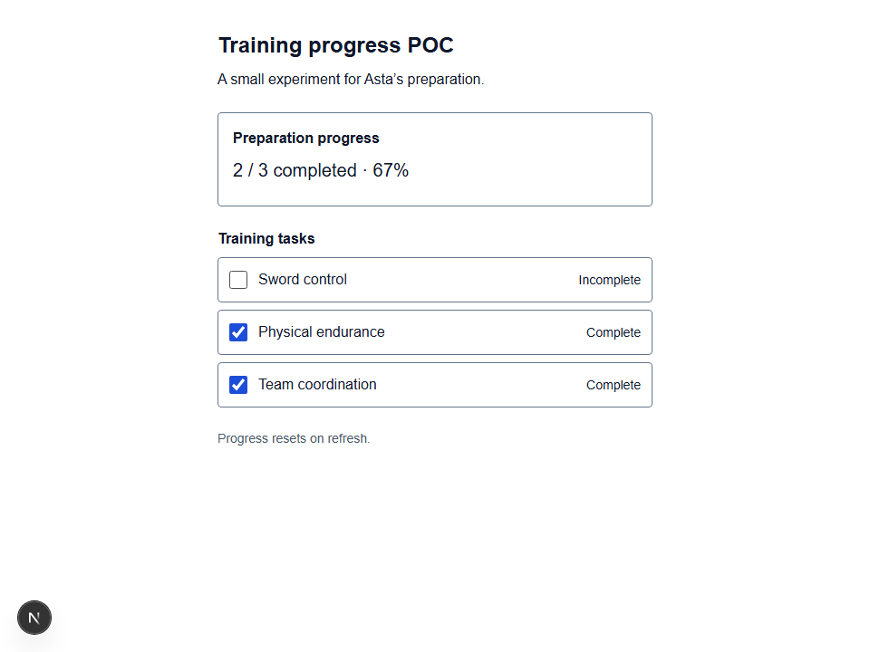

# Training progress proof of concept

Date: 16 October 2026. Decision: **Continue**.

## Question

Can task completion and the progress summary stay consistent when tasks are completed, undone, and toggled repeatedly?

## Approach

Build one plain Next.js client screen with three predefined labels, native checkboxes, status text, a completed / total count, and a percentage. All tasks start incomplete. No artwork, full dashboard styling, database, or persistence is included.

Keep the task array as the single source of truth. A functional state update toggles the selected task. Derive the count from current completed tasks and calculate `Math.round(completed / total * 100)` each render. Do not maintain separate count or percentage state.

## Actual test results

Tested the running local Next.js app using headless Chromium with the bundled Playwright library. The CLI launcher was unavailable in this environment. The retained browser runner is `scripts/check-poc.cjs` in the application repository; its results compare displayed values against actual checkbox states after each action.

| Action | Actual result | Outcome |
| --- | --- | --- |
| Start with no tasks complete | 0 / 3 and 0% | Pass |
| Complete Sword control | 1 / 3 and 33% | Pass |
| Complete Physical endurance | 2 / 3 and 67% | Pass |
| Complete Team coordination | 3 / 3 and 100% | Pass |
| Undo Sword control | 2 / 3 and 67% | Pass |
| Toggle Sword control 20 times | Alternates between 3 / 3, 100% and 2 / 3, 67%; every result matches checkbox states | Pass |
| Exercise all eight completion combinations | Each count and percentage matches checked tasks, including every one-task and two-task combination | Pass |
| Refresh | Resets to 0 / 3 and 0% | Pass |
| Space completes and undoes a focused checkbox | 1 / 3, 33%, then 0 / 3, 0% | Pass |
| View at 320px | No horizontal page overflow | Pass |

All **36 state assertions passed**; no browser page errors were recorded during the successful run. Lint and TypeScript checks passed. The Webpack production build passed and generated the single dashboard route.

## Issue or observation

The default Turbopack development server returned HTTP 500 because its CSS worker failed to spawn with an access-denied error. Retrying outside the sandbox produced the same failure. Switching to the built-in Webpack compiler allowed the page to run and the browser checks to pass. Basic CSS keeps this experiment readable without depending on generated utility styles under that fallback. This is an environment/build-tool observation, not a task-state failure.

The rounding is intentional: one task is 33% and two tasks are 67%. Adding a fixed 33 for each task would give the wrong result at full completion; deriving progress from current task states avoids that drift.

## Decision

**Continue** to the MVP. The central interaction passed completion, undo, repeated-toggle, and combination checks. Reuse the task-state logic while adding the agreed design later. Investigate the Turbopack worker issue before relying on the default development command. This POC does not validate the full design, screen-reader behaviour, all browsers, or the product with users.

## Run and reproduce

From `asta/`, run `npm run dev -- --webpack`, then open http://127.0.0.1:3000. Use the table above for a manual repeat.

For the saved automation, make the Playwright package available to Node (the recorded run used the bundled runtime via `NODE_PATH`) and run `node scripts/check-poc.cjs`. The runner writes screenshots and JSON results under `output/playwright/`. No test dependency was added to the application.

## Evidence and Git history

- [Initial state screenshot](evidence/poc-initial.png).
- [After undo screenshot](evidence/poc-after-undo.png): two checked tasks, 2 / 3 completed, 67%.
- [320px screenshot](evidence/poc-mobile.png).
- [Actual browser results](evidence/poc-results.json).

The Git repository is `asta/`, on branch `assignment-2-asta-mvp`. Before this experiment, that branch contained only the inherited starter commit, `14a7aab`. The experiment is committed with the message **Test training progress proof of concept**. Documentation and evidence are copied into `asta/docs/` so they are preserved with the code; the workspace-level `docs/POC.md` retains the same report.

