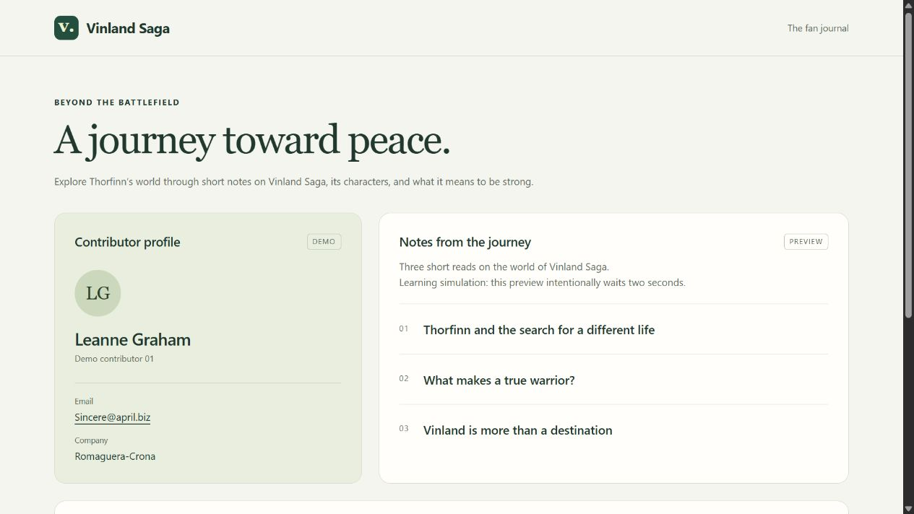
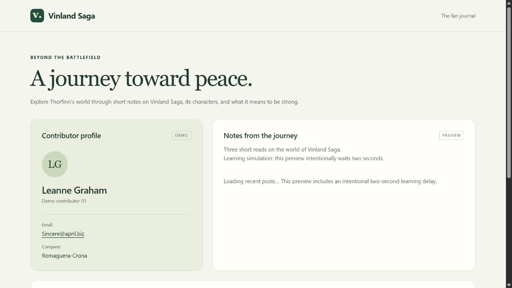
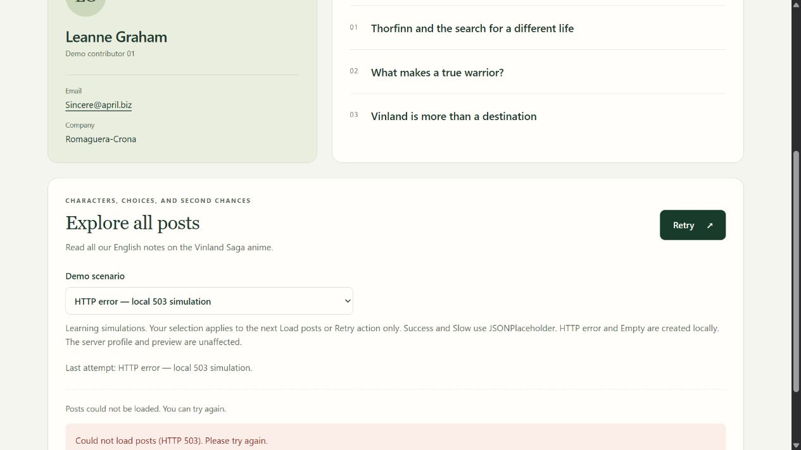
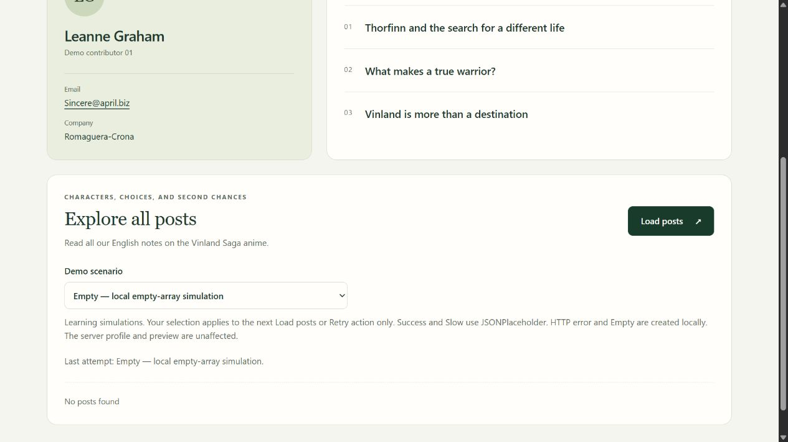
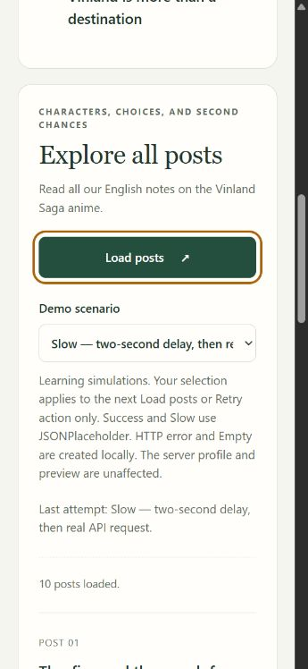

# Testing

The main checks passed. The profile loaded, the preview showed its loading message, and the client handled success, errors, empty results, and retries. The page also worked at 360px wide.

## Results

**Server profile**

- Expected: Showing full employee details.
- Actual: Leanne Graham, Sincere@april.biz, and Romaguera-Crona from `/users/1`.
- Result: Pass.

**Server preview**

- Expected: A loading message while the rest of the page stays visible.
- Actual: The shell arrived at 127 ms. Three titles arrived at 2,130 ms.
- Result: Pass.

**Client idle**

- Expected: No fetch before clicking.
- Actual: The code test counted zero requests before clicking, even after changing the selector. I could not reach the local dev server in the browser for a new Network-panel check in this environment.
- Result: Pass in the code test; browser Network check remains unverified.

**Client slow**

- Expected: Loading feedback and no duplicate requests.
- Actual: The controls were disabled, then 10 API posts appeared. Two rapid clicks made one request in the code test. The browser Network-panel request count was not verified.
- Result: Pass.

**Client success**

- Expected: Post titles and bodies.
- Actual: Saw the returned API title and body for each post, followed by separately labelled fan-note content where available. The browser Network-panel request count was not verified.
- Result: Pass.

**HTTP failure**

- Expected: Catch the custom error and offer Retry.
- Actual: The local 503 showed an error and Retry. The code test confirmed `ApiError` with status 503. Browser Network-panel request count was not verified.
- Result: Pass.

**Empty response**

- Expected: “No posts found” without an error.
- Actual: Saw that message after the local empty response. No error appeared. Browser Network-panel request count was not verified.
- Result: Pass.

**Recovery**

- Expected: Retry successfully after an error.
- Actual: Switched from HTTP error to Success and clicked Retry. Posts appeared and the error cleared.
- Result: Pass.

**Section independence**

- Expected: The server sections stay when the client fails.
- Actual: The profile and three preview titles stayed visible during the client error.
- Result: Pass.

**Usability**

- Expected: Labels, visible keyboard focus, and a readable page at 360px.
- Actual: Labels and focus were visible. Text wrapped without sideways scrolling.
- Result: Pass.

The fake-fetch code test checks request counts and handler behavior in isolation. The browser Network panel separately confirmed the client request counts below. The rendered API title/body remain visible; fan notes are additional labelled content.

## Browser Network check

Chrome Network-panel screenshots confirm no client API request before clicking, one `posts?userId=1` request for Success and Slow, and no request for the local Empty or HTTP error simulations. See `docs/screenshots/network-*.png`.

## Commands

**npm run lint**

- Expected: No lint errors.
- Actual: Passed on the host with exit code 0. npm was unavailable in the sandbox.
- Result: Pass.

**npm run build**

- Expected: Build without errors.
- Actual: Finished with exit code 0 using Turbopack.
- Result: Pass.

Both commands were run for this report.

## Screenshots and steps

These are screenshots of the running app. Timing was measured separately: the preview through a fresh HTTP response, and Slow mode through the code test. Slow waited 2,006 ms before fetching. A screenshot alone cannot prove timing.

### Normal

Reloaded `/` and waited for the profile and three preview titles. Left the client explorer idle.

### Server-preview loading

Reloaded `/` and captured the loading message. The rest of the page stayed visible. The two-second pause is an intentional learning simulation.

### Client error

Selected HTTP error and clicked Load posts. The 503 was created locally. The server sections stayed visible.

### Empty

Selected Empty and clicked the action button. The empty response was created locally, not returned by JSONPlaceholder.

### Mobile keyboard focus

At 360px, Shift+Tab focused Load posts. Tab then moved to Demo scenario. Both had a visible focus outline.

## Not tested

- A real API outage or a real 503 from JSONPlaceholder.
- Screen-reader output and other browsers.

## Why a manual boundary?

`loading.tsx` shows a loading screen while a page loads. A shared header can stay visible above it.

Here, a manual Suspense boundary shows loading only in the preview. `await connection()` makes the demo wait for a real request. I used direct reloads because navigation and prefetching can change what appears.

Neither option is always better. A click request uses its own React loading state; Suspense does not watch the click handler’s fetch.
